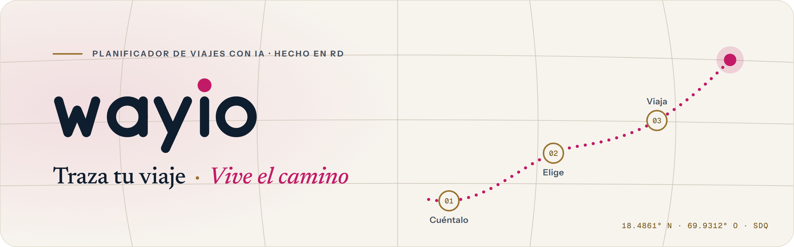
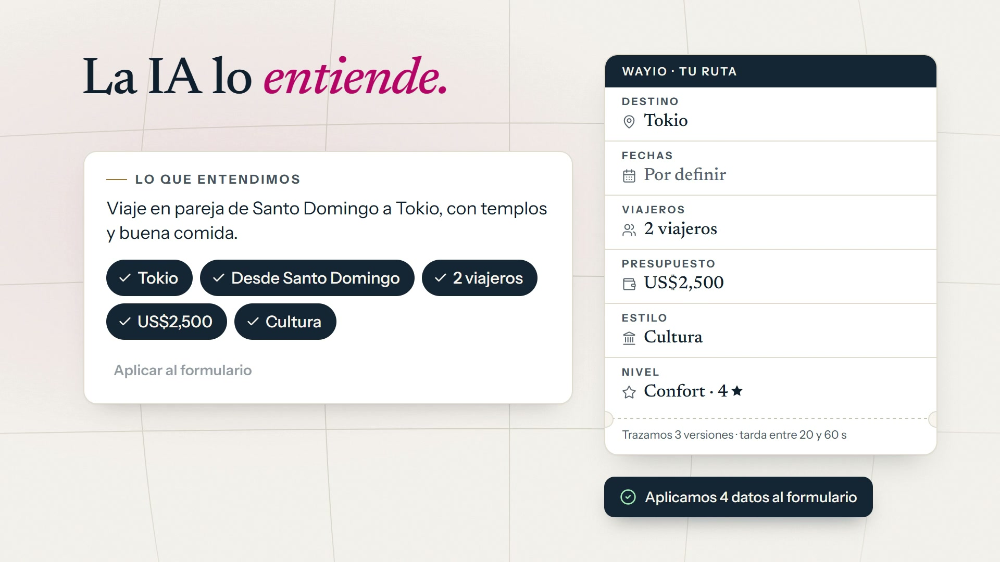
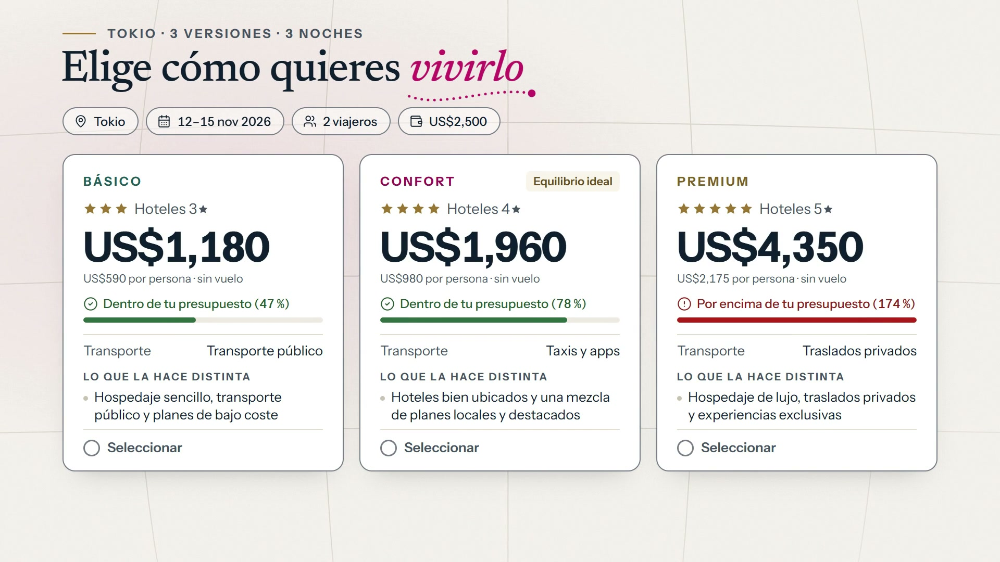
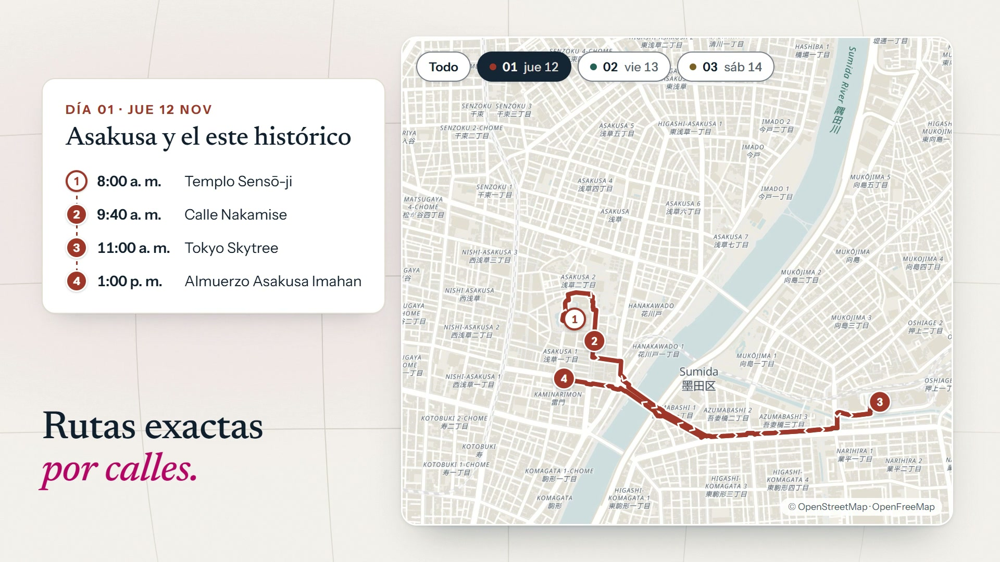
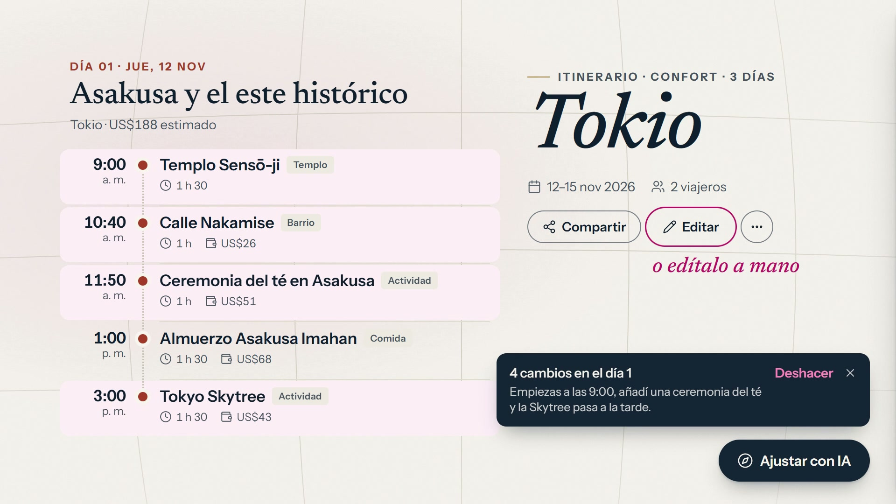
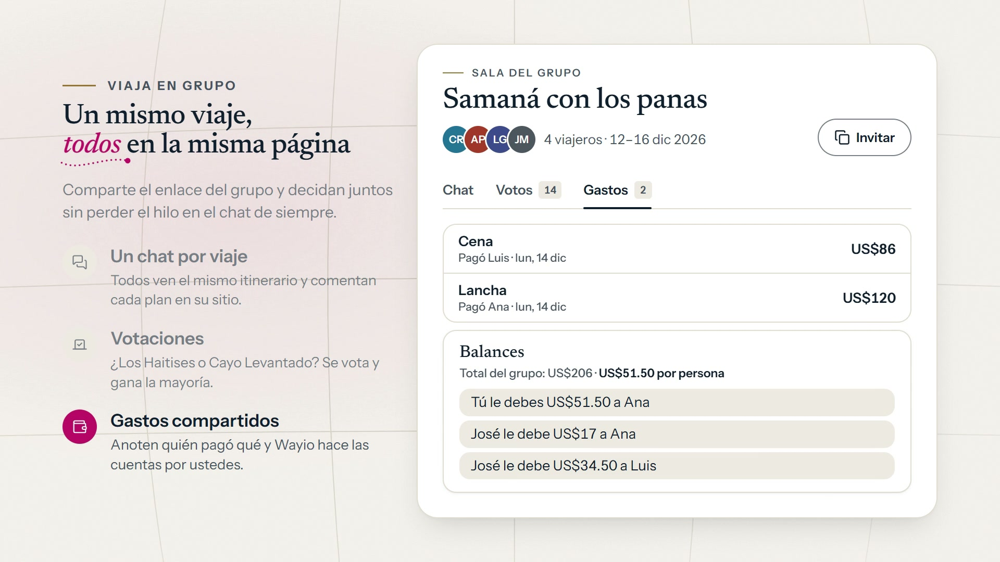

<p align="center">
  <a href="https://wayio-ten.vercel.app">
    <picture>
      <source media="(prefers-color-scheme: dark)" srcset="docs/readme/banner-oscuro.png">
      
    </picture>
  </a>
</p>

<p align="center">
  <b>Cuéntanos qué imaginas.</b> Wayio arma tres versiones de tu itinerario, con horarios, mapa y presupuesto en USD, EUR o DOP. <i>Tú eliges.</i>
</p>

<p align="center">
  <a href="https://wayio-ten.vercel.app"><b>Probar Wayio</b></a>
  &nbsp;·&nbsp;
  <a href="#videos">Ver los videos</a>
  &nbsp;·&nbsp;
  <a href="#arrancar">Arrancar en local</a>
  &nbsp;·&nbsp;
  <a href="#documentacion">Documentación</a>
</p>

<p align="center">
  
  
  
  
  
  
</p>

<p align="center">
  
</p>

## `01` Qué es Wayio

**Traza tu viaje · Vive el camino.** Planificador de viajes con IA en español: le cuentas tu viaje y Wayio arma tres versiones del itinerario (básico, confort y premium) con horarios reales, mapa, presupuesto en USD/EUR/DOP y enlaces para reservar. Después puedes ajustarlo, guardarlo, compartirlo, viajar en grupo y seguirlo en vivo con GPS.

<table>
  <tr>
    <td width="33%" valign="top">
      <code>01</code> <b>Cuéntanos</b><br>
      <sub>Destino, fechas, viajeros y presupuesto. La IA se encarga del resto.</sub>
    </td>
    <td width="33%" valign="top">
      <code>02</code> <b>Compara 3 versiones</b><br>
      <sub>Básico, Confort y Premium, con sus hoteles, su ritmo y cuánto encajan con tu presupuesto, lado a lado.</sub>
    </td>
    <td width="33%" valign="top">
      <code>03</code> <b>Viaja con el mapa en vivo</b><br>
      <sub>Tu itinerario día a día con horarios y mapa, seguido en vivo con GPS y también sin conexión.</sub>
    </td>
  </tr>
</table>

<a id="videos"></a>

## `02` Míralo en acción

<p align="center">
  <a href="https://cdn.jsdelivr.net/gh/RandyGrullon/Wayio@499e238d11ea850765bbd1808653dfdc53d8428e/docs/videos/01-global-horizontal.mp4">
    
  </a>
  <br>
  <b>Wayio en 25 segundos</b>
  &nbsp;·&nbsp; ▸ <a href="https://cdn.jsdelivr.net/gh/RandyGrullon/Wayio@499e238d11ea850765bbd1808653dfdc53d8428e/docs/videos/01-global-horizontal.mp4">Horizontal</a>
  &nbsp;·&nbsp; ▸ <a href="https://cdn.jsdelivr.net/gh/RandyGrullon/Wayio@499e238d11ea850765bbd1808653dfdc53d8428e/docs/videos/01-global-vertical.mp4">Vertical</a>
</p>

<table>
  <tr>
    <td width="50%" valign="top">
      <a href="https://cdn.jsdelivr.net/gh/RandyGrullon/Wayio@499e238d11ea850765bbd1808653dfdc53d8428e/docs/videos/web/08-tutorial-horizontal.mp4"></a>
    </td>
    <td width="50%" valign="top">
      <sub><code>TUTORIAL · 88 s</code></sub><br>
      <b>Cómo usar Wayio, <i>paso a paso</i></b>
      <br><br>
      Seis estaciones con la app real y la lista de lo que hay que hacer en cada una, con los nombres exactos de los botones: cuéntalo, elige tu versión, recorre el mapa, ajusta con IA, viaja en grupo y vive el viaje.
      <br><br>
      ▸ <a href="https://cdn.jsdelivr.net/gh/RandyGrullon/Wayio@499e238d11ea850765bbd1808653dfdc53d8428e/docs/videos/web/08-tutorial-horizontal.mp4">Horizontal</a>
      &nbsp;·&nbsp; ▸ <a href="https://cdn.jsdelivr.net/gh/RandyGrullon/Wayio@499e238d11ea850765bbd1808653dfdc53d8428e/docs/videos/web/08-tutorial-vertical.mp4">Vertical</a>
    </td>
  </tr>
</table>

<table>
  <tr>
    <td width="33%" valign="top">
      <a href="https://cdn.jsdelivr.net/gh/RandyGrullon/Wayio@499e238d11ea850765bbd1808653dfdc53d8428e/docs/videos/02-cuentalo-horizontal.mp4"></a>
      <br><code>01</code> <b>Cuéntalo</b> <i>a tu manera</i> <sub>· 20 s</sub><br>
      <sub>Escríbelo como se lo contarías a un amigo: la IA lo entiende y solo te pregunta lo que falta.</sub><br>
      <sub>▸ <a href="https://cdn.jsdelivr.net/gh/RandyGrullon/Wayio@499e238d11ea850765bbd1808653dfdc53d8428e/docs/videos/02-cuentalo-horizontal.mp4">Horizontal</a> · ▸ <a href="https://cdn.jsdelivr.net/gh/RandyGrullon/Wayio@499e238d11ea850765bbd1808653dfdc53d8428e/docs/videos/02-cuentalo-vertical.mp4">Vertical</a></sub>
    </td>
    <td width="33%" valign="top">
      <a href="https://cdn.jsdelivr.net/gh/RandyGrullon/Wayio@499e238d11ea850765bbd1808653dfdc53d8428e/docs/videos/03-versiones-horizontal.mp4"></a>
      <br><code>02</code> <b>Elige</b> <i>tu versión</i> <sub>· 20 s</sub><br>
      <sub>Básico, Confort y Premium del mismo viaje, con cuánto encaja cada uno en tu presupuesto.</sub><br>
      <sub>▸ <a href="https://cdn.jsdelivr.net/gh/RandyGrullon/Wayio@499e238d11ea850765bbd1808653dfdc53d8428e/docs/videos/03-versiones-horizontal.mp4">Horizontal</a> · ▸ <a href="https://cdn.jsdelivr.net/gh/RandyGrullon/Wayio@499e238d11ea850765bbd1808653dfdc53d8428e/docs/videos/03-versiones-vertical.mp4">Vertical</a></sub>
    </td>
    <td width="33%" valign="top">
      <a href="https://cdn.jsdelivr.net/gh/RandyGrullon/Wayio@499e238d11ea850765bbd1808653dfdc53d8428e/docs/videos/04-mapa-horizontal.mp4"></a>
      <br><code>03</code> <b>Recorre</b> <i>el mapa</i> <sub>· 19 s</sub><br>
      <sub>Rutas exactas por calles, cada día en su color y cómo llegar a cada parada.</sub><br>
      <sub>▸ <a href="https://cdn.jsdelivr.net/gh/RandyGrullon/Wayio@499e238d11ea850765bbd1808653dfdc53d8428e/docs/videos/04-mapa-horizontal.mp4">Horizontal</a> · ▸ <a href="https://cdn.jsdelivr.net/gh/RandyGrullon/Wayio@499e238d11ea850765bbd1808653dfdc53d8428e/docs/videos/04-mapa-vertical.mp4">Vertical</a></sub>
    </td>
  </tr>
  <tr>
    <td width="33%" valign="top">
      <a href="https://cdn.jsdelivr.net/gh/RandyGrullon/Wayio@499e238d11ea850765bbd1808653dfdc53d8428e/docs/videos/05-asistente-horizontal.mp4"></a>
      <br><code>04</code> <b>Vive</b> <i>el viaje</i> <sub>· 22 s</sub><br>
      <sub>Sabe cuándo llegas y, si vas tarde, la IA te propone el mejor hueco libre de tu itinerario.</sub><br>
      <sub>▸ <a href="https://cdn.jsdelivr.net/gh/RandyGrullon/Wayio@499e238d11ea850765bbd1808653dfdc53d8428e/docs/videos/05-asistente-horizontal.mp4">Horizontal</a> · ▸ <a href="https://cdn.jsdelivr.net/gh/RandyGrullon/Wayio@499e238d11ea850765bbd1808653dfdc53d8428e/docs/videos/05-asistente-vertical.mp4">Vertical</a></sub>
    </td>
    <td width="33%" valign="top">
      <a href="https://cdn.jsdelivr.net/gh/RandyGrullon/Wayio@499e238d11ea850765bbd1808653dfdc53d8428e/docs/videos/06-ajustar-horizontal.mp4"></a>
      <br><code>05</code> <b>Ajusta</b> <i>con IA</i> <sub>· 20 s</sub><br>
      <sub>Pide cambios en lenguaje natural; siempre puedes deshacer el último ajuste o editar a mano.</sub><br>
      <sub>▸ <a href="https://cdn.jsdelivr.net/gh/RandyGrullon/Wayio@499e238d11ea850765bbd1808653dfdc53d8428e/docs/videos/06-ajustar-horizontal.mp4">Horizontal</a> · ▸ <a href="https://cdn.jsdelivr.net/gh/RandyGrullon/Wayio@499e238d11ea850765bbd1808653dfdc53d8428e/docs/videos/06-ajustar-vertical.mp4">Vertical</a></sub>
    </td>
    <td width="33%" valign="top">
      <a href="https://cdn.jsdelivr.net/gh/RandyGrullon/Wayio@499e238d11ea850765bbd1808653dfdc53d8428e/docs/videos/07-grupo-horizontal.mp4"></a>
      <br><code>06</code> <b>Viaja</b> <i>en grupo</i> <sub>· 22 s</sub><br>
      <sub>El mismo itinerario para todos, un chat por viaje, votaciones y los gastos con las cuentas hechas.</sub><br>
      <sub>▸ <a href="https://cdn.jsdelivr.net/gh/RandyGrullon/Wayio@499e238d11ea850765bbd1808653dfdc53d8428e/docs/videos/07-grupo-horizontal.mp4">Horizontal</a> · ▸ <a href="https://cdn.jsdelivr.net/gh/RandyGrullon/Wayio@499e238d11ea850765bbd1808653dfdc53d8428e/docs/videos/07-grupo-vertical.mp4">Vertical</a></sub>
    </td>
  </tr>
</table>

<sub>Los originales en 1920×1080 y 1080×1920, sus miniaturas y los textos para publicar en redes están en <a href="docs/videos/"><code>docs/videos/</code></a>.</sub>

## `03` Qué hay en el repo

> [!NOTE]
> Los videos y la app en producción ya muestran el rediseño **«Cuaderno de Ruta»** (texto libre interpretado por la IA, rutas exactas por calles, «Cómo llegar», deshacer ajustes, unirse a un grupo por enlace). Ese código vive en la rama [`rediseno-ui-ia`](https://github.com/RandyGrullon/Wayio/tree/rediseno-ui-ia) hasta que se fusione con `main`.

| Carpeta           | Qué es                                                                                                                                                                                            |
| ----------------- | ------------------------------------------------------------------------------------------------------------------------------------------------------------------------------------------------- |
| `src/app`         | Web en **Next.js 16** (App Router): landing `/`, viaje guardado `/trip/[id]`, compartido `/viaje-compartido/[id]`, grupos `/group/[id]`, guías SEO `/viaje/[destino]`, `/login` y panel `/admin`. |
| `src/app/api`     | Backend: generación con IA (también en streaming), ajustes, reagendado, validación, análisis de video, vuelos y hoteles, geocoding, viajes, grupos (chat, votos, gastos, ubicación) y Stripe.     |
| `src/lib/ai`      | Núcleo de IA: cliente Anthropic/Groq, generación de las tres versiones, optimización de rutas, reagendado, validación de horarios y registro de uso.                                              |
| `src/lib/offline` | Copia local del itinerario para seguir el viaje sin conexión.                                                                                                                                     |
| `supabase`        | Esquema completo (`schema.sql`), migraciones, plantillas de correo y guía de auth.                                                                                                                |
| `mobile`          | App **Expo** (React Native) con las mismas funciones y modo en vivo con GPS y geofencing.                                                                                                         |
| `docs/videos`     | Serie de videos de la app (global, seis funciones y tutorial), en horizontal y vertical.                                                                                                          |
| `docs/readme`     | Banner, isotipo y ruta de este README.                                                                                                                                                            |

**Stack:** React 19, Tailwind CSS 4, framer-motion, MapLibre + OpenFreeMap, Supabase (Postgres + Auth + Realtime), Anthropic SDK, Zod, Stripe, PostHog, Sentry.

<a id="arrancar"></a>

## `04` Arrancar en local

```bash
npm install
cp .env.example .env.local   # y rellena lo que quieras activar (ver API-KEYS-GUIA.md)
npm run dev                  # http://localhost:3000
```

Sin ninguna clave la app corre en **modo demo** (itinerario de ejemplo, sin login). Para IA real basta `ANTHROPIC_API_KEY` (o `GROQ_API_KEY` con `AI_PROVIDER=groq`). La guía completa de servicios está en [**API-KEYS-GUIA.md**](API-KEYS-GUIA.md) y lo que falta para producción en [**PENDIENTE.md**](PENDIENTE.md).

App móvil: ver [`mobile/README.md`](mobile/README.md) (para los módulos nativos necesita un _dev build_, no Expo Go).

## `05` Scripts

| Comando                       | Qué hace                                      |
| ----------------------------- | --------------------------------------------- |
| `npm run dev`                 | Servidor de desarrollo                        |
| `npm run build` / `npm start` | Build y servidor de producción                |
| `npm run validate`            | type-check + lint + formato (lo mismo que CI) |
| `npm run pre-deploy`          | `validate` + `build`, antes de desplegar      |
| `npm run lint:fix`            | Corrige lo que ESLint puede arreglar solo     |
| `npm run format`              | Formatea todo el repo con Prettier            |

<a id="documentacion"></a>

## `06` Documentación

- [API-KEYS-GUIA.md](API-KEYS-GUIA.md) — cómo obtener y configurar cada servicio.
- [API_KEYS_FALTANTES.md](API_KEYS_FALTANTES.md) — qué claves faltan por configurar.
- [PENDIENTE.md](PENDIENTE.md) — estado del proyecto y pasos para terminarlo.
- [ADMIN.md](ADMIN.md) — panel de administración.
- [supabase/CONFIGURACION-AUTH.md](supabase/CONFIGURACION-AUTH.md) — autenticación paso a paso.
- [mobile/README.md](mobile/README.md) — app móvil con Expo.
- [docs/videos/](docs/videos/) — videos de la app y textos para publicar.

<p align="center">
  
</p>

<p align="center">
  <picture>
    <source media="(prefers-color-scheme: dark)" srcset="docs/readme/iso-oscuro.svg">
    
  </picture>
</p>

<p align="center">
  <b>Traza tu viaje · <i>Vive el camino</i></b><br>
  <sub><code>18.4861° N · 69.9312° O</code> · Hecho en RD</sub>
</p>
